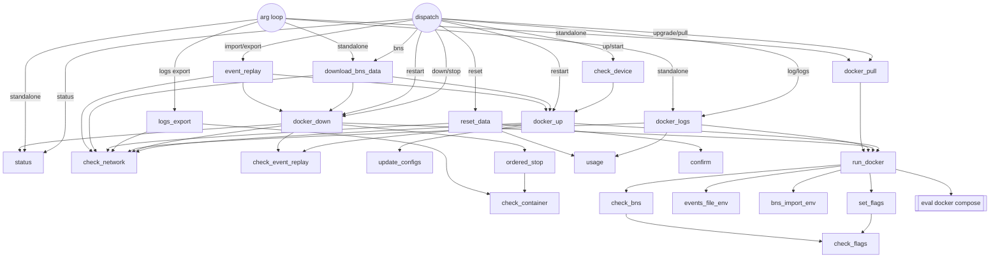

# 03 — `manage.sh` Internals

All line numbers refer to `manage.sh` at `d2e558c`.

## Execution phases

| Phase | Lines | What happens |
|---|---|---|
| 1. Shell options | 3-5 | `set -eo pipefail`, `set -Eo functrace` (no `ERR`/`RETURN` traps are defined, so `-E`/`functrace` have no effect), `shopt -s expand_aliases` |
| 2. Hard defaults | 8-19 | `NETWORK=mainnet` (exported), `ACTION=""` (exported), `PROFILE=stacks-blockchain` (exported), `SIGNER=false`, `STACKS_CHAIN_ID=2147483648`, `STACKS_SHUTDOWN_TIMEOUT=1200`, `LOG_TAIL=100`, `FLAGS=proxy` (unused), `LOG_OPTS="-f --tail 100"`, `VERBOSE=false`, `REVERT_BNS=false`, `REVERT_EVENTS=false` |
| 3. Colors/labels | 21-55 | ANSI constants; `ERROR`, `WARN`, `INFO` (`[ Success ]`), `EXIT_MSG`, `DEBUG` |
| 4. Paths and `.env` | 59-68 | `SCRIPTPATH` = physical dir of `$0` (exported); `ENV_FILE=$SCRIPTPATH/.env`; `ENV_FILE_TMP` (unused). If `.env` is missing → `cp -a sample.env .env`. Then `source .env` (**not** `set -a`, so variables are not exported unless they were already) |
| 5. Logging aliases | 71-99 | `log`, `log_error`, `log_warn`, `log_info`, `log_exit` aliases; verbose variants when `VERBOSE` is true; `logger()` and `exit_error()` printf formatters (`exit_error` exits 1) |
| 6. Discovery | 101-147 | `DEFAULT_SERVICES=(stacks-blockchain stacks-blockchain-api postgres)` (stop order and log-export set); `SUPPORTED_FLAGS` from `extra-services/*.yaml`; `SUPPORTED_NETWORKS` from `networks/*.yaml`; `SUPPORTED_ACTIONS` hard-coded |
| 7. Function definitions | 151-915 | see the function reference below |
| 8. Preflight | 918-932 | require `docker` and `id`; require `docker compose version`; no args → `usage` |
| 9. Exports | 934-940 | `USER_ID=$(id -u $(whoami))`, `DOCKER_NETWORK`, `STACKS_CHAIN_ID` exported |
| 10. Arg loop | 944-1064 | see [02](./02-cli-reference.md) |
| 11. Post-parse | 1067-1099 | require `ACTION`; map `NETWORK` → `STACKS_CHAIN_ID` (`mainnet`=`0x00000001`, `testnet`=`0x80000000`, else `2147483648`); export `STACKS_CHAIN_ID`, `NETWORK`, `PG_SHMSIZE` |
| 12. Dispatch | 1102-1149 | `case $ACTION`; final `exit 0` |

## Global state

| Variable | Initial | Mutated by | Read by | Exported |
|---|---|---|---|---|
| `NETWORK` | `mainnet` → `.env` → `-n` | arg loop; **any re-`source` of `.env`** (`bns_import_env`, `events_file_env`) | nearly everything | yes |
| `ACTION` | `""` | arg loop | dispatch, `docker_down`, `check_event_replay` (log text only) | yes |
| `PROFILE` | `stacks-blockchain` | `download_bns_data` → `bns`; `event_replay` → `event-replay` | `check_network`, `docker_up/down`, `ordered_stop`, `run_docker` | yes |
| `SIGNER` | `false` | `docker_up` (substring match on `FLAGS_ARRAY`) | `update_configs` | no |
| `FLAGS` | `proxy` (dead default) | `-f` | logging only | no |
| `FLAGS_ARRAY` | unset | `-f` (one element holding the whole comma string); `download_bns_data` → `(bns)`; `event_replay` → `(api-<action>-events)` | `docker_up` | no |
| `SUPPORTED_FLAGS` | from dir listing | `+= bns` / `+= api-<action>-events` | `set_flags`, `docker_down/logs/pull` | no |
| `OPTIONAL_FLAGS` | `""` | `set_flags` | `run_docker` | no |
| `STACKS_CHAIN_ID` | `2147483648` | post-parse case | compose interpolation (API `environment`) | yes |
| `USER_ID` | computed | — | `bns.yaml` | yes |
| `DOCKER_NETWORK`, `PG_SHMSIZE` | from `.env` | — | compose interpolation | yes (explicitly) |
| `SCRIPTPATH` | computed | — | compose interpolation, all paths | yes |
| `REVERT_BNS`, `REVERT_EVENTS` | `false` | toggled by `bns_import_env` / `events_file_env` | the same functions | no |
| `BNS_IMPORT_DIR`, `STACKS_EXPORT_EVENTS_FILE` | from `.env` | `unset` by the mocknet toggles; re-sourced | `check_bns`, `download_bns_data`, `event_replay` | no |
| `BNS_FILES` | **never defined in manage.sh** | — | `check_bns` (iterates over nothing) | — |
| `IFS` | default | `-f` sets `IFS=','` **globally** and never restores it | every unquoted expansion afterwards | — |
| `noglob` (`set -f`) | off | `-f` turns it on globally | every glob afterwards (e.g. `check_bns`) | — |

## Function reference

### Output helpers

| Function | Lines | Behavior |
|---|---|---|
| `logger` | 84-90 | Non-verbose: `printf "%-25s %s\n" $1 $2`. Verbose: 6-field layout with timestamp/func/line/DEBUG |
| `exit_error` | 92-99 | Same format plus a blank line, then `exit 1` |
| `usage` | 151-166 | Prints usage; **`exit 0`** (also on every error path) |
| `confirm` | 169-179 | `read -r -n 1 -p "<msg> [y/n]: "`; y/Y → 0, n/N → 1, else "invalid input" and loop. **At EOF on stdin it loops forever** **[V]** |

### Predicates

| Function | Lines | Returns 0 when | Notes |
|---|---|---|---|
| `check_flags <space/IFS-joined list> <item>` | 183-194 | item is in list | Unquoted `for i in ${array}`, so it depends on the current `IFS` (works whether `IFS` is `' '` or `','` because callers join with `${arr[*]}`) |
| `check_device` | 198-208 | — | If `uname -m` == `arm64` → warning + `confirm "Continue Anyway?"` or exit 1. Linux arm64 reports `aarch64` and is not affected **[S]** |
| `check_network <profile>` | 233-245 | `docker compose -f common.yaml --profile 
 ps -q` prints anything | Uses only `common.yaml` and no `--env-file`, so it is **not network-specific**. With profile `bns` there are no services in common.yaml, so it always reports "not running" |
| `check_event_replay` | 248-314 | no replay in progress, or replay finished | Greps `docker logs stacks-blockchain-api`: the first 20 lines for `Importing raw event requests` / `Export started`, the last 20 lines for `Event import and playback successful` / `Export successful`. `\|\| test $? -eq 141` treats SIGPIPE as a match. Relies on `set -e` being suppressed because it is always called inside `if !` |
| `check_container <name>` | 317-328 | `docker ps -f name=^<name>$ -q` non-empty | Anchored exact-name match |
| `check_bns` | 331-349 | always, in practice | If `BNS_IMPORT_DIR` is set and `persistent-data$BNS_IMPORT_DIR` exists, it lists the files and checks each `BNS_FILES` entry. `BNS_FILES` is undefined here, so the check is a no-op **[S]** |
| `check_api` | 212-230 | — | **Commented out.** Formerly compared the major version of the local API image with `.env` to detect breaking schema changes; caller block at 634-650 also commented |

### Mutators of `.env` (mocknet only)

| Function | Lines | Behavior |
|---|---|---|
| `events_file_env` | 395-435 | If `REVERT_EVENTS`: uncomment `^#STACKS_EXPORT_EVENTS_FILE=` in `.env`, set `REVERT_EVENTS=false`. Then, if `STACKS_EXPORT_EVENTS_FILE` is set: comment it, set `REVERT_EVENTS=true`, `unset`. Always: `cat .env \| grep …` (prints unconditionally) and `source .env` |
| `bns_import_env` | 352-392 | Same pattern for `BNS_IMPORT_DIR` |

Both are called twice by `run_docker` around `up` when `NETWORK == mocknet`. The purpose is to keep the API container from receiving these vars on mocknet, since `env_file: .env` passes everything through. **Because both functions re-`source` `.env`, `NETWORK` gets reset to the `.env` value between the two calls, so the second (revert) call is skipped whenever `.env` says something other than `mocknet` [V].**

### Config rendering

`update_configs` (438-517) **[V]**:

1. If `NETWORK == testnet`, alias `BTC_HOST/BTC_RPC_USER/BTC_RPC_PASS/BTC_RPC_PORT/BTC_P2P_PORT` to their `TBTC_*` counterparts and `SIGNER_PRIVATE_KEY` to `TESTNET_SIGNER_PRIVATE_KEY`. (`TBTC_RPC_USER` and `TBTC_RPC_PASS` are not defined anywhere, so they end up empty.)
2. **Signer disabled** (`SIGNER != true`): GNU sed program on `Config.toml`. Starting at an uncommented `[[events_observer]]`, it accumulates lines until one matches `endpoint.*stacks-signer`, then prefixes every accumulated line with `#` (`s/^/#/mg`). It also comments `stacker = true`.
3. **Signer enabled**: abort with "Signer private key not set!" if the key is empty (checked before any write). Otherwise run the reverse sed (uncomment the block and `stacker = true`), create `Signer.toml` from the sample if missing, and rewrite `node_host`, `endpoint`, `metrics_endpoint`, `auth_password`, `stacks_private_key`.
4. Create `Config.toml` from the sample if missing (in practice `docker_up` has already done this). Rewrite `peer_host`, `username`, `password`, `rpc_port`, `peer_port`, `auth_token`, the signer observer `endpoint`, and `prometheus_bind`. Only lines that already exist and start with those keys are rewritten; nothing is added.
5. Remove the `*.tmp` backups that `sed -i.tmp` left behind.

The toggles are idempotent under GNU sed: disabling twice is stable, and enable after disable restores the sample byte-for-byte **[V]**. The full key/variable mapping is in [06](./06-configuration-reference.md).

### Compose assembly

| Function | Lines | Behavior |
|---|---|---|
| `set_flags <flags…>` | 521-564 | Builds `OPTIONAL_FLAGS`. First `-f extra-services/postgres.yaml` if `EXPOSE_POSTGRES` evaluates true (the value is *executed* as a command: `${EXPOSE_POSTGRES} && …`). Then, for each supported flag, `-f compose-files/<flag_path>/<flag>.yaml`, where `flag_path` is `event-replay` if `profile == event-replay`, else `extra-services`. **`profile` is not a parameter: it is read from the caller's (`run_docker`) `local profile` through bash dynamic scoping.** A missing file errors only when the profile is not `stacks-blockchain` |
| `run_docker <action> <flags> <profile> [param]` | 868-915 | `cmd="docker compose --env-file $ENV_FILE -f common.yaml -f networks/$NETWORK.yaml $OPTIONAL_FLAGS --profile $profile $action $param"`. Around `up`: mocknet → env toggles before and after; mainnet/testnet → `check_bns` gate. Runs `eval "$cmd"`. Prints success for `up`/`down` unless profile is `bns`. Under `set -e`, a failing `eval` exits right away, so the post-`up` revert and the `ret` handling never run on failure **[S]** |

### Lifecycle

| Function | Lines | Behavior |
|---|---|---|
| `ordered_stop` | 567-593 | If `common.yaml` and the network file exist and `compose ps -q stacks-blockchain` succeeds (always succeeds, even if nothing is running), then for each of `DEFAULT_SERVICES` that is running: `docker compose … --profile $PROFILE stop [-t $STACKS_SHUTDOWN_TIMEOUT] <svc>` (timeout only for `stacks-blockchain`). Returns 0. The "not running → return 1" branch is effectively unreachable |
| `docker_up` | 596-658 | Refuse if running; refuse if a replay is in progress; `SIGNER=true` if a flag contains "signer"; `param=-d` (empty for `bns`, which runs in the foreground); create `Config.toml` from the sample; dead `private-testnet` branch; mainnet/testnet: `mkdir -p persistent-data/<net>/event-replay` if `persistent-data/<net>` is missing; `update_configs`; `cp -a .env .env.save`; `run_docker up "$FLAGS_ARRAY[*]" $PROFILE $param` |
| `docker_down` | 661-685 | If not running: call `status` (prints and **exits 1**) unless `ACTION == restart`, then return. Refuse if a replay is in progress. mainnet/testnet and profile ≠ bns → `ordered_stop`. Then `run_docker down "$SUPPORTED_FLAGS[*]" $PROFILE` (every extra-services file) |
| `docker_logs <opts>` | 688-698 | Not running → error + usage (exit 0). Else `run_docker logs <all flags> $PROFILE "-f --tail 100"` |
| `logs_export` | 701-727 | Not running → error + usage. `mkdir -p exported-logs`; for each `DEFAULT_SERVICES` that is running: `docker logs <svc> > exported-logs/<svc>.log 2>&1` (overwrite); exit 0. Signer and nginx logs are **not** exported |
| `docker_pull` | 730-734 | `run_docker pull <all flags> $PROFILE` |
| `status` | 737-750 | Running → exit 0 (verbose: prints `compose ps`). Not running → exit 1 |
| `reset_data` | 753-778 | If `persistent-data/<net>` exists: if not running → `confirm` → `rm -rf` (on failure suggests sudo) → exit 0; if running → exit 1. If no data → error + usage (exit 0) |
| `download_bns_data` | 781-810 | Requires `BNS_IMPORT_DIR`. If not running: `SUPPORTED_FLAGS+=bns`, `FLAGS_ARRAY=(bns)`, `PROFILE=bns`; require `bns.yaml`; `docker_up` (foreground; also runs `update_configs` and `.env.save`); `docker_down`, which for profile `bns` always sees "not running" and calls `status`, so it **exits 1 here** and the completion message is never printed **[V]** |
| `event_replay <import\|export>` | 813-865 | Refuse API `5.0.1` (stale guard). Require `STACKS_EXPORT_EVENTS_FILE`. Check `persistent-data/**mainnet**/event-replay/<basename>`: if missing, log an error and **continue anyway** **[V]**. If running → `docker_down`. `PROFILE=event-replay`; flags `api-<action>-events`; require that compose file; `docker_up` (detached); print instructions; exit 0 |

## Call graph

## Shell mechanics the current behavior depends on

These are easy to break by accident during a refactor:

1. **`set -e` is suppressed inside conditionals.** `check_event_replay` deliberately lets `grep -q` fail; it only works because every caller uses `if ! check_event_replay`. Calling it bare would abort the script.
2. **`pipefail` and SIGPIPE.** `docker logs … | head | grep -q` can exit 141; this is normalized with `|| test $? -eq 141`.
3. **The `$(cmd 2>&1) || { log_exit …; }` pattern** (used about a dozen times). The command runs inside a command substitution and its *output* is then executed as a command. With empty output it works. If `sed`/`rm`/`cp` print anything, the shell tries to run that text, fails, and the `||` branch fires. It works by accident.
4. **`eval` of string-built commands.** Every compose invocation is built as a string and `eval`ed, so paths containing spaces or shell metacharacters (e.g. a `SCRIPTPATH` with spaces) would break.
5. **Dynamic scoping.** `set_flags` reads `profile` from its caller's local scope.
6. **Global `IFS=','` / `set -f` after `-f`.** Later `${arr[*]}` joins use `,` and unquoted splits use `,`. This happens to be consistent. Globs in `check_bns` would not expand, but that is masked by the `BNS_FILES` bug.
7. **Aliases inside functions.** Aliases are expanded when a function is *defined*. The verbose/non-verbose alias choice is made at lines 71-82, before any function definition, so `VERBOSE` from `.env` takes effect. Moving the `.env` sourcing below the function definitions would silently break verbose logging.
8. **`source .env` executes shell.** `.env` is parsed by bash here and by Docker Compose's dotenv parser in `--env-file`/`env_file`. Values with quotes, spaces, `$` or inline `#` can be read differently by the two parsers **[S]**.
9. **Variable export.** Compose interpolation sees only *exported* shell vars plus `--env-file`. `check_network` passes no `--env-file`; it gets by because the only required interpolations (`SCRIPTPATH`, `DOCKER_NETWORK`) are explicitly exported and the rest have `:-` defaults.
