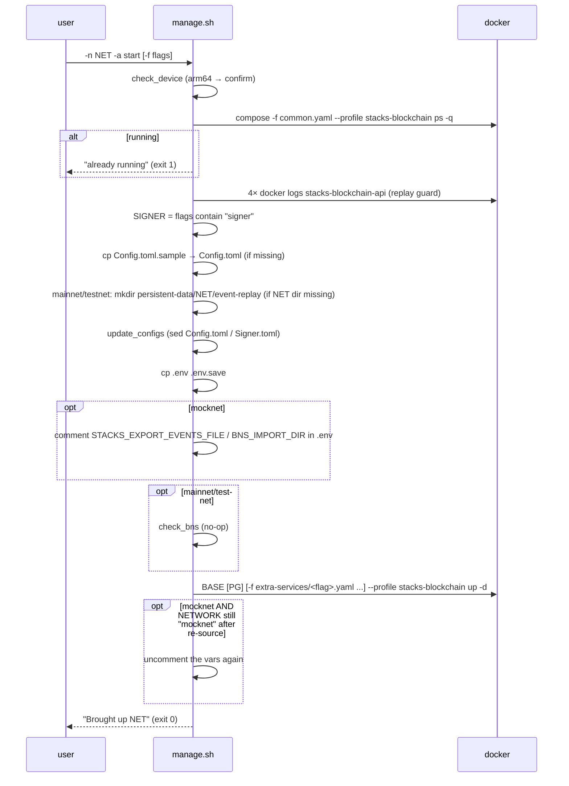
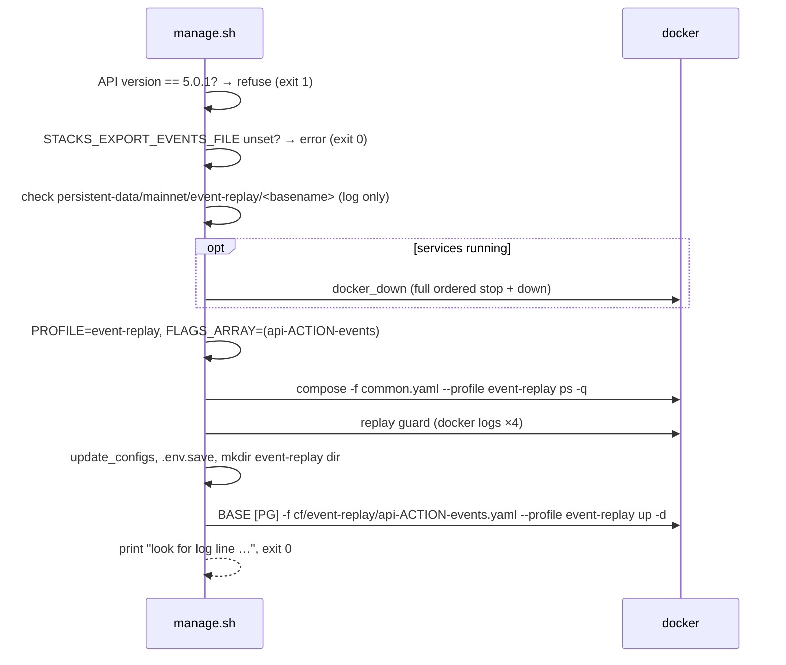

# 04 — Action Workflows

Abbreviations used in the commands below:
- `$R` = `SCRIPTPATH` (repo root)
- `cf/` = `$R/compose-files/`
- `BASE` = `docker compose --env-file $R/.env -f cf/common.yaml -f cf/networks/$NETWORK.yaml`
- `ALLX` = `-f cf/extra-services/bns.yaml -f cf/extra-services/postgres.yaml -f cf/extra-services/proxy.yaml -f cf/extra-services/signer.yaml` (alphabetical glob order)
- `PG` = `-f cf/extra-services/postgres.yaml`, prepended when `EXPOSE_POSTGRES=true`

The exact recorded command sequences are in [`harness/golden/`](./harness/golden/) **[V]**.

## Shared preamble (every invocation)

1. `.env` is created from `sample.env` if missing and then sourced.
2. `docker compose version` must succeed.
3. `USER_ID`, `DOCKER_NETWORK` and `STACKS_CHAIN_ID` are exported. After parsing, `STACKS_CHAIN_ID` is set from `NETWORK`, and `NETWORK` and `PG_SHMSIZE` are exported.

## Event-replay guard (`check_event_replay`)

`start`, `restart`, `stop`, `import`, `export` and `bns` run four `docker logs stacks-blockchain-api` probes first:

| Probe | Window | Pattern |
|---|---|---|
| import started | first 20 lines | `Importing raw event requests` |
| import finished | last 20 lines | `Event import and playback successful` |
| export started | first 20 lines | `Export started` |
| export finished | last 20 lines | `Export successful` |

The guard reports "in progress" (and the caller refuses) when *started* is found but *finished* is not. If the API container does not exist, every probe fails and the guard reports "not in progress".

---

## `start` / `up`



Command: `BASE [PG] [-f cf/extra-services/<flag>.yaml]… --profile stacks-blockchain up -d`

Files touched **[V]**:
- `conf/<net>/Config.toml`: created, and signer block commented or uncommented
- `conf/<net>/Signer.toml`: created and rewritten, signer only
- `.env.save`
- `persistent-data/<net>/event-replay/`: mainnet/testnet
- `.env`: mocknet only; left modified if `.env` `NETWORK` ≠ `mocknet`

Compose start order: postgres and the API start independently (the API's `depends_on: postgres` is commented out). `stacks-blockchain` waits for `stacks-blockchain-api` to *start* (no health condition).

## `stop` / `down`

1. If not running → `status` → "not running", **exit 1**.
2. Replay guard; refuse if a replay is in progress.
3. **mainnet/testnet only (ordered stop):** for each running service among `stacks-blockchain`, `stacks-blockchain-api`, `postgres`, in that order:
   - `docker compose --env-file … -f common -f networks/NET --profile $PROFILE stop [-t $STACKS_SHUTDOWN_TIMEOUT] <svc>`
   - the timeout is only applied to `stacks-blockchain`; default 1200s, so the node runloop can finish cleanly and chainstate is not corrupted
4. `BASE [PG] ALLX --profile stacks-blockchain down`. This removes every container in the project (including signer and nginx) and the network. Bind-mounted data stays.
5. "Brought down NET", exit 0.

mocknet skips step 3, so its `down` uses Compose's default 10s stop timeout **[S]**.

## `restart`

`docker_down`: when nothing is running it returns silently (no `status` exit). Then `docker_up`. **The arm64 `check_device` prompt is not shown on restart.** The flags given to *this* call decide the signer/proxy state, so a `restart` without `-f signer` disables the signer **[V]**.

## `logs` / `log`

Not running → `No <net> services running` + usage (exit 0). Otherwise `BASE [PG] ALLX --profile stacks-blockchain logs -f --tail 100`. The call blocks until interrupted.

## `logs export`

Not running → error + usage. Otherwise `mkdir -p exported-logs`; for each running service in `stacks-blockchain`, `stacks-blockchain-api`, `postgres`: `docker logs <svc> > exported-logs/<svc>.log 2>&1` (overwritten each time); exit 0.

## `pull` / `upgrade`

`BASE [PG] ALLX --profile stacks-blockchain pull`. This pulls postgres, node, API, signer and nginx. It does **not** pull the `bash` image (profile `bns`). Running containers are not recreated; the user has to `restart`.

## `status`

`compose -f cf/common.yaml --profile stacks-blockchain ps -q` → "running" (exit 0) / "not running" (exit 1). Verbose mode also prints `docker compose -f common.yaml ps`.

## `reset`

```
persistent-data/<net> exists?
 ├─ no  → "No data exists for <net>" + usage (exit 0)
 └─ yes → services running?
          ├─ yes → "Can't reset while services are running" (exit 1)
          └─ no  → confirm "Delete Persistent data for <net>?"
                   ├─ n → "Delete Cancelled" (exit 1)
                   └─ y → rm -rf persistent-data/<net>
                          ├─ ok   → "Persistent data deleted" (exit 0)
                          └─ fail → suggest `sudo ./manage.sh -n <net> -a reset` (exit 1)
```

`persistent-data/bns-data` and the mocknet volumes (there are none) are not touched.

## `import` / `export` (API event replay)



Profile `event-replay` starts only **postgres** and **stacks-blockchain-api**. The API command is replaced:

| Action | Container command | Restart |
|---|---|---|
| export | `rm -f $STACKS_EXPORT_EVENTS_FILE` (if present) `&& node ./lib/index.js export-events --file $STACKS_EXPORT_EVENTS_FILE` | `"no"` |
| import | `node ./lib/index.js import-events --file $STACKS_EXPORT_EVENTS_FILE --wipe-db --force` | `"no"` |

`$STACKS_EXPORT_EVENTS_FILE` (default `/tmp/event-replay/stacks-node-events.tsv`) is mounted from:
- mainnet: `persistent-data/mainnet/event-replay`
- testnet: `persistent-data/testnet/event-replay`
- mocknet: `persistent-data/mainnet/event-replay`

The operator watches the logs for completion, then runs `restart`. The replay guard keeps `stop`/`start` from interrupting a replay in progress.

## `bns`

1. Requires `BNS_IMPORT_DIR` (commented out in `sample.env`); otherwise error, exit 0.
2. Refuses if services are running (exit 1).
3. `PROFILE=bns`, `FLAGS_ARRAY=(bns)` → `docker_up`:
   - `update_configs` runs (Config.toml is touched)
   - `.env.save` is written
   - mainnet/testnet persistent dir is created
   - **foreground** `BASE [PG] -f cf/extra-services/bns.yaml --profile bns up`
4. The `bns_data` container (`bash` image) runs `/scripts/setup-bns.sh` and writes into `persistent-data/bns-data` (see [07](./07-auxiliary-scripts.md)).
5. `docker_down` → `check_network bns` → always "not running" → `status` → **exit 1** **[V]**. The `bns_data` container is left behind in the *exited* state **[S]**.

## Mocknet `.env` toggle detail (start/restart/import/export)

| Step | Intended | Actual when `.env` has `NETWORK=mainnet` (default) **[V]** |
|---|---|---|
| before `up` | comment `STACKS_EXPORT_EVENTS_FILE` and `BNS_IMPORT_DIR`, then re-source `.env` | done; the re-source sets `NETWORK=mainnet` |
| `up` | containers get `.env` without those vars | done (compose was invoked with `networks/mocknet.yaml`, because `cmd` was built before the re-source) |
| after `up` | uncomment the vars | **skipped** (`NETWORK` is no longer `mocknet`); `.env` stays modified; success message says "Brought up **mainnet**" |
