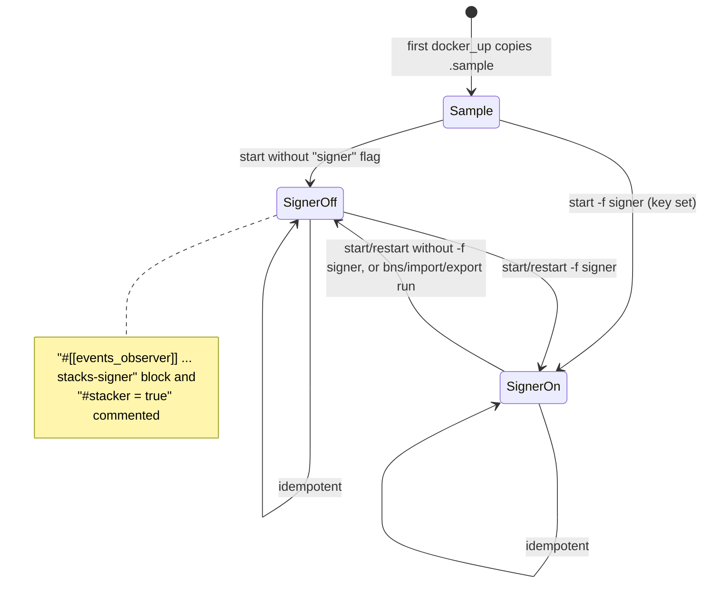

# 08 — Filesystem & Runtime State

## Generated paths

| Path | Created by | When | Owner | Removed by | Gitignored |
|---|---|---|---|---|---|
| `.env` | manage.sh / seed / upgrade (`cp -a sample.env`) | first run | user (root if run with sudo) | never | ✔ |
| `.env.save` | `docker_up` | every up/restart/import/export/bns | user | never (overwritten) | ✔ (`*.save`) |
| `.env.tmp` | `sed -i.tmp` in mocknet toggles | transient | user | same function | ✗ (transient) |
| `conf/<net>/Config.toml` | `docker_up` / `update_configs` (copied from `.sample`) | first up on that network | user | never | ✔ |
| `conf/<net>/Config.toml.tmp` | `sed -i.tmp` | transient | user | `update_configs` | ✗ |
| `conf/<net>/Signer.toml` | `update_configs` (signer only) | first signer up | user | never | ✔ |
| `persistent-data/<net>/event-replay/` | `docker_up` (`mkdir -p`) for mainnet/testnet, if `persistent-data/<net>` is missing; otherwise Docker on mount | first up | user / root | `reset` | ✔ |
| `persistent-data/<net>/stacks-blockchain/` | Docker bind mount (`create_host_path`) or seed | first up | **root** (Docker), or chowned by seed | `reset`, seed | ✔ |
| `persistent-data/<net>/postgres/` | Docker bind mount or seed | first up | postgres image uid (70 on alpine) | `reset`, seed, upgrade (mainnet) | ✔ |
| `persistent-data/<net>/stacks-signer/` | Docker bind mount | first signer up (mocknet included) | root | `reset` | ✔ |
| `persistent-data/bns-data/` | Docker bind mount (API always mounts it) | first up | root | **never** (`reset` is per network) | ✔ |
| `persistent-data/bns-data/{export-data.tar.gz, *.txt, *.csv, *.sha256}` | `setup-bns.sh` | `bns` | root (D11) | never | ✔ |
| `persistent-data/mainnet/event-replay/stacks-node-events.tsv` | API `export-events` (also used for testnet's path check and mocknet's mount) | `export` | container uid | export overwrites | ✔ |
| `exported-logs/<svc>.log` | `logs_export` | `logs export` | user | never (overwritten) | ✔ (dir and `*.log`) |
| `pg_dump/dump.sql` | `postgres-upgrade.sh` (in cwd) | upgrade | root (sudo) | upgrade (on success) | ✗ |
| `stacks-blockchain-api-pg-*.dump[.sha256]`, `<net>-blockchain-*.tar.zst`, `*.sha256` (in cwd) | `seed-chainstate.sh` | seed | root | seed (on success) | ✗ |

## Persistence by network

| Network | Chainstate | API DB | Signer DB | Survives `stop`? |
|---|---|---|---|---|
| mainnet | `persistent-data/mainnet/stacks-blockchain` | `persistent-data/mainnet/postgres` | `persistent-data/mainnet/stacks-signer` | yes |
| testnet | `persistent-data/testnet/…` | `persistent-data/testnet/postgres` | `persistent-data/testnet/stacks-signer` | yes |
| mocknet | container filesystem (no `working_dir`, no mount) | container filesystem | `persistent-data/mocknet/stacks-signer` | **no**. `down` removes the containers, so chain and DB restart from genesis; the signer DB persists and can then be inconsistent **[S]** |

## `Config.toml` signer state machine

`SignerOn` is byte-identical to the sample for those lines **[V]**. Every transition also rewrites the env-driven keys ([06](./06-configuration-reference.md)). Hand edits to the comment state, or to the order of the observer blocks, change what the multi-line sed matches.

## Docker-side state

| Object | Name | Lifetime |
|---|---|---|
| Compose project | `compose-files` | per up/down |
| Network | `${DOCKER_NETWORK}` (`stacks`) | created on up, removed on down |
| Containers | `postgres`, `stacks-blockchain`, `stacks-blockchain-api`, `stacks-signer`, `nginx`, `bns_data` | removed on `down` (except `bns_data`, see D10) |
| Ad-hoc containers | `postgres_import` (seed), `postgres_dump` (upgrade) | `--rm` |
| Images | the five service images + `bash` | `pull` updates them; never pruned |

## `.gitignore` coverage notes

- Ignores the right generated artifacts: `conf/*/Config.toml`, `conf/*/Signer.toml`, `.env`, `persistent-data/`, `exported-logs/`, `*.save`, `*.log`.
- **Stale entries** (paths that no longer exist): `stacks-node-follower/Config.toml`, `configurations/*`, `conf/private-testnet/*`, `conf/*/Config-with-bitcoin-flag.toml`, `conf/*/bitcoin.conf`, `packer/vars.json`.
- **Not ignored:** seed downloads (`*.dump`, `*.tar.zst`, `*.sha256`) and `pg_dump/`, all written to the repo root. An interrupted seed or upgrade leaves multi-GB untracked files behind.
